# 📡⚛️ Q6G-1TB — 6G 1 Tbps Internet Quantum Computer

**🌐 A 6G network that targets 1 terabit per second, guarded by a quantum computer, with a sandbox-api chamber checking every payload before it is studied — all in one pure-Python project.**

👨‍💻 By Darion Kellar · 📜 MIT License · 🐍 Python stdlib only, zero dependencies · 🏷️ v1.2.0


---

## 🔄 Updated Workflows

Two workflows ship in `workflow-pack/` — paste each one into `.github/workflows/` on GitHub (the App cannot write workflow files, so this paste is the owner's step):

| Workflow | File to create | What it does |
|---|---|---|
| ✅ CI | `.github/workflows/ci.yml` | On every push + pull request: Python 3.12 → install pytest → `pytest tests/ -q` → `python main.py checks` |
| 🐳 Docker Publish | `.github/workflows/docker-publish.yml` | On push to `main`: Docker Hub login from secrets → build + push `credkellar/q6g-1tb:latest` |

Secrets needed (repo → Settings → Secrets → Actions): `DOCKERHUB_USERNAME`, `DOCKERHUB_TOKEN`.

[](https://github.com/credkellar/Q6G-1TB/actions/workflows/ci.yml)
[](https://github.com/credkellar/Q6G-1TB/actions/workflows/docker-publish.yml)

> ⚠️ **Honest badge note:** the two badges above are static on purpose. The real `badge.svg` URLs were checked live and return **404** until the workflow files are pasted and run for the first time — after that, swap these for the live workflow badges. Every other badge in this README was checked live: **HTTP 200**.

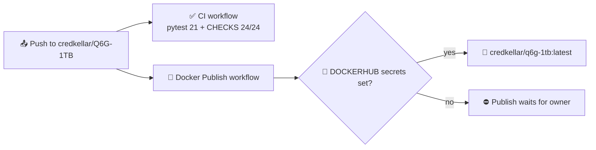

---

## 🧰 Tech Stack Badges & Full Architecture Tech Stack


### 💻 Core Programming Languages & Core Systems
- 🐍 **Python 3.12** — the whole system, one language
- 📚 **Standard library only** — `cmath`, `math`, `random`, `hashlib`, `tempfile`, `argparse`, `json`; zero pip installs
- ⚛️ **Statevector quantum engine** — complex-amplitude simulation, 1–12 qubits

### ⛓️ Web3 & Infrastructure
- 🚫 **No blockchain** — honestly none; this is a network + quantum project
- 🔐 **BB84 quantum key distribution** — the security layer for the Q-SLICE
- 🧪 **sandbox-api chamber** — merged from Darion's own `credkellar/sandbox-api` line (8,393 pulls when first catalogued); the chamber code here is copied **verbatim** (sha256 `28b3365c…`) from his MonadDB-RE implementation of it
- 🎭 **DI-MIXER** — merged from `credkellar/di-mixerx` (227 pulls, Hub-verified 2026-11-10): synthetic decoy device identities; TEST-NET + documentation ranges only, never transmitted
- 🗺️ **Network management topology** — engine ported from Darion's LLM-X-NetLab (bus / star / ring / mesh / tree + SPOF analysis), re-pointed at 6G management domains
- 🎬 **Google Flow** — all 4 flows (FlowX, Workspace Studio, Filmmaking, DataX) as plan-only seats; rendered = False, live calls = 0

### ⚙️ Platform Support & Hardware Architecture
- 🖥️ **Any OS** that runs Python 3.12 (Linux, macOS, Windows, Termux)
- 📡 **Modelled radio** — 256-antenna massive MIMO, 8 streams, bands at 60 / 140 / 300 GHz (modelled, not physical hardware)
- 🐳 **Docker** — `python:3.12-slim`, non-root user

### ⚡ Low-Level Infrastructure & Performance
- 🧮 **Real link math** — Shannon capacity + free-space path loss, computed live on every report
- 🎯 **Deterministic seeds** — every simulation is reproducible run-to-run
- 🪶 **No heavy deps** — the full test suite runs in under a second

### 🔧 DevOps & Build Tools
- ✅ **GitHub Actions CI** — pytest + self-checks (paste step, see Updated Workflows)
- 🐳 **Docker Publish** — to Docker Hub `credkellar/q6g-1tb`
- 🧪 **pytest** — 21 tests · 🔎 **built-in CHECKS** — 24/24

### ☁️ Cloud Providers
- 🚫 **None required** — everything runs locally, offline
- 🧠 **Optional brain seat** — Muse via the Meta Model API (`MODEL_API_KEY`, names-only, advisory only, pay-as-you-go — never labelled free)

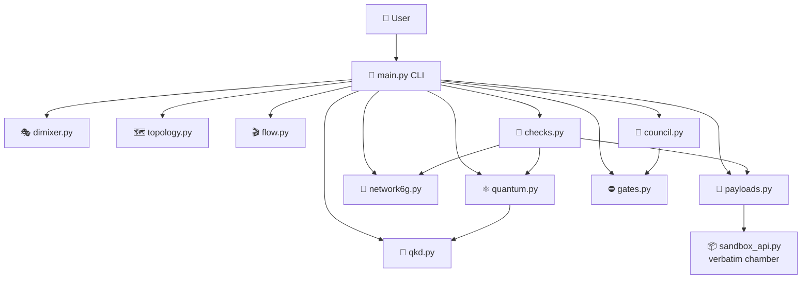

---

## ❓ What is this about?

📖 This project is about the **next internet after 5G** — called **6G** — and the **quantum computers** that will help run and protect it.

Three ideas are joined into one machine:

1. 📡 **Speed** — a 6G link designed to reach **1 terabit per second** (1,000,000,000,000 bits every second).
2. ⚛️ **Quantum** — a quantum computer core that can hold many answers at once, teleport a quantum state, and search a haystack the fast quantum way.
3. 🛡️ **Safety** — quantum keys that reveal any spy, a sandbox chamber that studies payloads without ever running them, and hard HOLD gates on everything live.

⚠️ It is a **working simulation and model**, honestly labelled: real 6G is not commercially deployed yet, and no physical 1 Tbps link or live quantum hardware is claimed. The math, the quantum circuits, the key exchange, and the chamber all really run.

## 🎯 What this does?

Step by step, one `python main.py demo` run:

1. ⚛️ Builds a **Bell pair** — two qubits linked so measuring one fixes the other (probabilities 0.5 / 0 / 0 / 0.5).
2. 🌀 Builds a **GHZ state** — three qubits in one shared state.
3. ✨ **Teleports** a qubit state from qubit 0 to qubit 2 and measures the recovery: **fidelity 1.0**.
4. 🔍 Runs **Grover search** on 4 qubits and finds the marked state with **96.13%** success probability.
5. 📡 Computes the **6G link**: 24 GHz of aggregated bandwidth × 8 MIMO streams × Shannon efficiency at the modelled SNR → **1.10 Tbps at 100 m**.
6. ⏱️ Checks **latency**: 0.0703 ms total — inside the 0.1 ms URLLC++ target.
7. 🚀 Runs a **simulated speed test** (labelled simulated in its own output): ~1.04 Tbps average.
8. 🔐 Runs **BB84 QKD** twice — clean channel gets a key; with an eavesdropper the error rate jumps past 11% and the key **aborts**.
9. 🧪 Sends **7 payloads through the sandbox-api chamber** — 4 clean ones are allowed for static study, 3 dangerous ones (eval, socket, shell markers) are **held**, nothing is executed, network attempts = 0.
10. 🎭 Raises a **DI-MIXER decoy pool** — 32 synthetic device identities (TEST-NET IPs, documentation IPv6, locally-administered MACs); a scanner sees only decoys, 0 real devices.
11. 🗺️ Maps the **network topology** five ways (bus / star / ring / mesh / tree) and names every single point of failure — star's hub is the SPOF, mesh has none.
12. 🎬 Plans with **all 4 Google Flows** — storyboard, docs and task plans; nothing rendered, 0 live calls.
13. 🧠 Asks the **council**: Gemini Carbon 4 Extended Thinking decides (MAP → MODEL → STRESS → DECIDE), Muse advises with exactly 4 items (authority: none), strictest wins.
14. ⛔ Confirms all **16 HOLD gates** are armed.

## ⚙️ How this works?

### 📡 The 1 Tbps math (derived, not typed)

`capacity = bandwidth × log2(1 + SNR) × MIMO streams × (1 − overhead)`

| Piece | Value |
|---|---|
| 📶 Aggregated bandwidth | 24 GHz (2 @ 60 GHz + 10 @ 140 GHz + 12 @ 300 GHz) |
| 🔀 MIMO streams | 8 |
| 📡 Antennas | 256 (beamforming gain ≈ 24.08 dB) |
| 📊 SNR @ 100 m | 20.25 dB (from free-space path loss `20·log10(d_km) + 20·log10(f_GHz) + 92.45`) |
| 🧮 Spectral efficiency | 6.74 bps/Hz/stream |
| ✂️ Overhead | 15% |
| 🏁 **Modelled capacity** | **1.10 Tbps ✅** |

Move the receiver to 1 km and the same formula drops below target — a test asserts that falloff, because that is the physics talking.

### ⚛️ The quantum core
A statevector of complex amplitudes. Gates (H, X, Y, Z, S, Rx, Ry, Rz, CNOT, CZ, SWAP) rewrite the amplitudes; measurement samples them. Teleportation uses the coherent form of the classical corrections (X controlled by qubit 1, Z controlled by qubit 0), so the recovered state can be checked exactly instead of statistically.

### 🔐 The quantum keys
BB84: Alice sends bits in random bases, Bob measures in random bases, they keep only the matching-basis bits. An eavesdropper must guess bases and corrupts about 25% of the sifted key — past the 11% abort line, so the key is thrown away and the spy is exposed.

### 🧪 The chamber
Every payload is data only. The chamber writes it to a throwaway folder, runs a static marker scan, records telemetry (sha256, bytes, FS diff, trace, budgets), and deletes the folder. It imports no socket machinery at all: network attempts are 0 **by design**, and sample code executed is always `False`.

### 🧠 The council
**Gemini Carbon 4 Extended Thinking** is the DECIDER (`google/gemini-carbon-4-extended-pro-thinking`, MAP → MODEL → STRESS → DECIDE trace on every decision; risk ≥ 75 → HOLD, ≥ 40 → REVIEW, else ALLOW_SIM; thinking tiers 2048 / 8192 / 32768 with 32768 the extended default; `GEMINI_API_KEY` by presence only; it can only tighten). **Muse** (`muse-spark-1.1` / `muse-wonder-1.0`) is an advisor with authority **none** — exactly 4 advice items, key names-only (`MODEL_API_KEY`, pay-as-you-go, never labelled free), the value never printed or stored. Neither seat makes a live call. Strictest outcome wins.

### 🎭 The decoys (DI-MIXER)
A rotating pool of synthetic device identities stands in front of the real network. Every decoy is labelled SYNTHETIC, every IPv4 is from the RFC 5737 TEST-NET ranges, every IPv6 from the 2001:db8::/32 documentation prefix, and every MAC has the locally-administered bit set — so a decoy can never be, or be mistaken for, a real device. Nothing is transmitted; putting spoofed identifiers on a live network is a HOLD gate.

### 🗺️ The topology map
The management domain is modelled five ways. Star is cheapest and its hub (node 0) is a single point of failure; ring and mesh have no SPOF. The engine also computes link counts and worst-case hops per topology, so the trade-off is measured, not guessed.

## 😎 Why is this is cool?

Because it takes three things people usually only draw on slides — 6G, 1 Tbps, and a quantum computer — and turns them into code you can run, measure, and break, in under a second, with nothing to install.

### 🔟 10 reasons why this is cool

1. 🏁 The **1 Tbps number is derived** from real formulas live — change the distance or antennas and it moves.
2. ✨ **Teleportation fidelity is measured** (1.0), not asserted — it failed at 0.96 during development and the circuit was fixed until the math closed.
3. 🔍 **Grover really amplifies** the marked state to 96.13% — quantum search, not a lookup.
4. 🕵️ **BB84 catches its spy the real way** — QBER past 11% aborts the key.
5. 🧪 The **sandbox-api chamber** studies payloads with executed = False and network = 0 on every single run, proven by tests.
6. 📉 **Capacity falloff with distance is a test**, not a hope — the model is not allowed to flatter itself.
7. 🏷️ The **speed test labels itself simulated** inside its own output — no fake flexing.
8. 🪶 **Zero dependencies** — the entire future internet runs on the Python standard library.
9. 🧠 The **advisor can never override the decider** — the council is built so advice cannot loosen a HOLD.
10. ⛔ **16 named HOLD gates** stand between this simulation and the live world — hardware, spectrum, carrier networks, spoofing, video rendering, live AI calls, all of it.

## 🧩 What problems this solves?

1. 🤷 **"6G" is mostly marketing slides.** → This gives it equations, defaults, and tests you can argue with.
2. 🔢 **Peak-speed claims are usually just typed.** → Here 1 Tbps falls out of bandwidth × Shannon × streams, and falls apart honestly at distance.
3. 🎓 **Quantum computing feels untouchable.** → Bell, GHZ, teleportation, and Grover run in ~180 lines of readable stdlib Python.
4. 🔓 **Future networks need new security.** → BB84 shows quantum keys that expose eavesdroppers by physics, not by trust.
5. 💣 **Studying unknown payloads is dangerous.** → The chamber analyses them as data only, in a throwaway folder, with budgets.
6. 🧪 **Demos hide their failures.** → CHECKS (24/24) and pytest (21) are part of the program, and the demo prints raw outputs.
7. 🏷️ **Simulations pretend to be measurements.** → Every output that is modelled or simulated says so in itself.
8. 📦 **Big installs kill curiosity.** → Zero dependencies: clone, run, done.
9. 🤖 **AI advisors get too much power in other systems.** → Here Muse advises and Carbon 4 decides; strictest wins, always.
10. 🌍 **One repo per idea fragments the work.** → Network, quantum, security, chamber, and council live behind **one** `main.py`.

### 🔟 10 solutions (the short list)

1. ✅ Formula-first link budget (Shannon + FSPL) instead of a typed headline number.
2. ✅ Distance-falloff test so the model cannot overclaim.
3. ✅ Statevector simulator with exact fidelity checks.
4. ✅ BB84 with a hard 11% QBER abort.
5. ✅ Static chamber: no execution, no sockets, step + time budgets, FS-diff telemetry.
6. ✅ Marker-scan triage: eval / socket / shell payloads are held automatically (3 of 7 demo payloads).
7. ✅ Deterministic seeds — every number in this README reproduces.
8. ✅ Self-labelling outputs: "modelled" and "simulated" travel with the data.
9. ✅ Council with tighten-only decider and a no-authority advisor.
10. ✅ 16 HOLD gates + a hold-demo that exits 2, so the boundary is testable too.

## 💾 How to install this? Step-by-step

1. 🐍 Install **Python 3.12** (any OS).
2. 📥 Clone the repo:
   ```bash
   git clone https://github.com/credkellar/Q6G-1TB.git
   cd Q6G-1TB
   ```
3. 🚀 Run the full demo — nothing to install first:
   ```bash
   python main.py demo
   ```
4. 🎛️ Or run one part at a time:
   ```bash
   python main.py quantum     # ⚛️ Bell / GHZ / teleport / Grover
   python main.py network     # 📡 1 Tbps link report + slices
   python main.py speedtest   # 🚀 simulated speed test
   python main.py qkd         # 🔐 BB84 clean vs eavesdropped
   python main.py sandbox     # 🧪 chamber triage of 7 payloads
   python main.py dimixer     # 🎭 DI-MIXER decoy pool + scanner view
   python main.py topology    # 🗺️ topology report + SPOF analysis
   python main.py flow        # 🎬 all 4 Google Flows, plan only
   python main.py council     # 🧠 Carbon 4 + Muse
   python main.py checks      # 🔎 self-checks (CHECKS 24/24)
   python main.py hold-demo   # ⛔ HOLD gate fires, exit 2
   ```
5. 🧪 (Optional) Run the test suite:
   ```bash
   pip install pytest
   python -m pytest tests/ -q   # 21 passed
   ```
6. 🐳 (Optional) Run it in Docker:
   ```bash
   docker build -t q6g-1tb .
   docker run --rm q6g-1tb demo
   ```
7. 🔄 (Owner step) Paste `workflow-pack/ci.yml` and `workflow-pack/docker-publish.yml` into `.github/workflows/`, add the two Docker Hub secrets, and CI + publishing go live.
8. 🖼️ (Owner step) Upload `assets/cover.png` to the repo — binary files cannot ride the App push, so the cover is an upload step.

## 📋 Requirements?

- 🐍 **Python 3.12+** — required. Nothing else.
- 📦 **pip packages: none** for running. `pytest` only if you want the test suite.
- 🐳 **Docker: optional**, only for the container run.
- 🔑 **API keys: none** for the simulation. `MODEL_API_KEY` only names the optional Muse advisor seat; the system runs fully without it.
- 🌐 **Internet: not required** — every engine is local and deterministic.
- 💻 **Hardware: any** machine that runs Python — the quantum sim caps at 12 qubits so it stays light.

## 🧒 Explain in 5th grade English

Imagine the internet is a road for tiny cars that carry messages. 🚗

5G is a good road. This project draws a **super road** called 6G that is so wide, a **trillion** tiny cars can drive on it every second. That is what "1 Tbps" means — one trillion bits, every single second. 🏁

Next to the road is a special kind of computer called a **quantum computer**. A normal computer thinks about one answer at a time. A quantum computer can hold **many answers at once**, like holding a whole handful of keys and trying the right one super fast. ⚛️

The quantum computer also makes **magic keys** for locking messages. If a spy tries to peek at a magic key, the key breaks — so we always know someone peeked, and we throw that key away. 🔐

Before any new package is opened, it goes into a **glass box room** (the sandbox chamber). We look at it through the glass, take notes, and never, ever run it. If it looks dangerous, it stays in the box. 🧪

There are also **toy robot phones** (the DI-MIXER decoys). They pretend to be real phones so nosy strangers look at the toys instead of your real phone. Every toy has a big label that says "TOY" — well, "SYNTHETIC" — and their numbers come from a special list that can never belong to a real phone. 🎭

And we draw **maps of the roads** (topology). On one map, all roads go through one middle town — if that town closes, nobody can travel. That is called a single point of failure. On the roundabout and spider-web maps, there is always another way around. 🗺️

And there is a **rule keeper** (Gemini Carbon 4) and a **helper** (Muse). The helper can give ideas, but only the rule keeper makes decisions, and the keeper can only make rules *stricter*, never weaker. ⛔

None of this is plugged into the real world. It is a **model** — like a toy city that follows the real rules — so we can learn exactly how the real one should work. 🏙️

---

## 📜 Script-by-script — a mermaid flowchart for each script

### 🚪 `main.py` — the one entry point

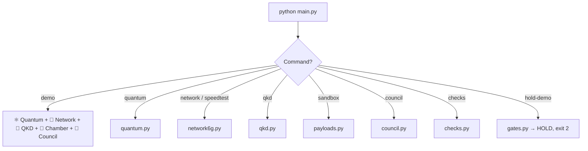

### ⚛️ `q6g/quantum.py` — statevector quantum computer

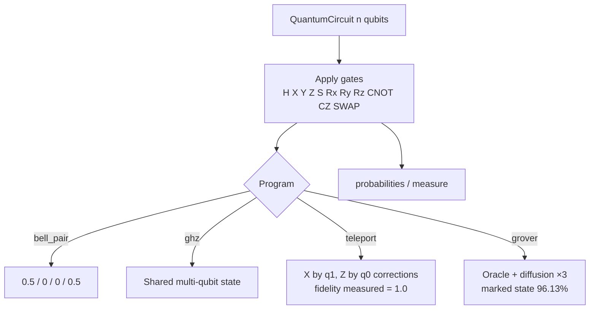

### 📡 `q6g/network6g.py` — the 6G 1 Tbps engine

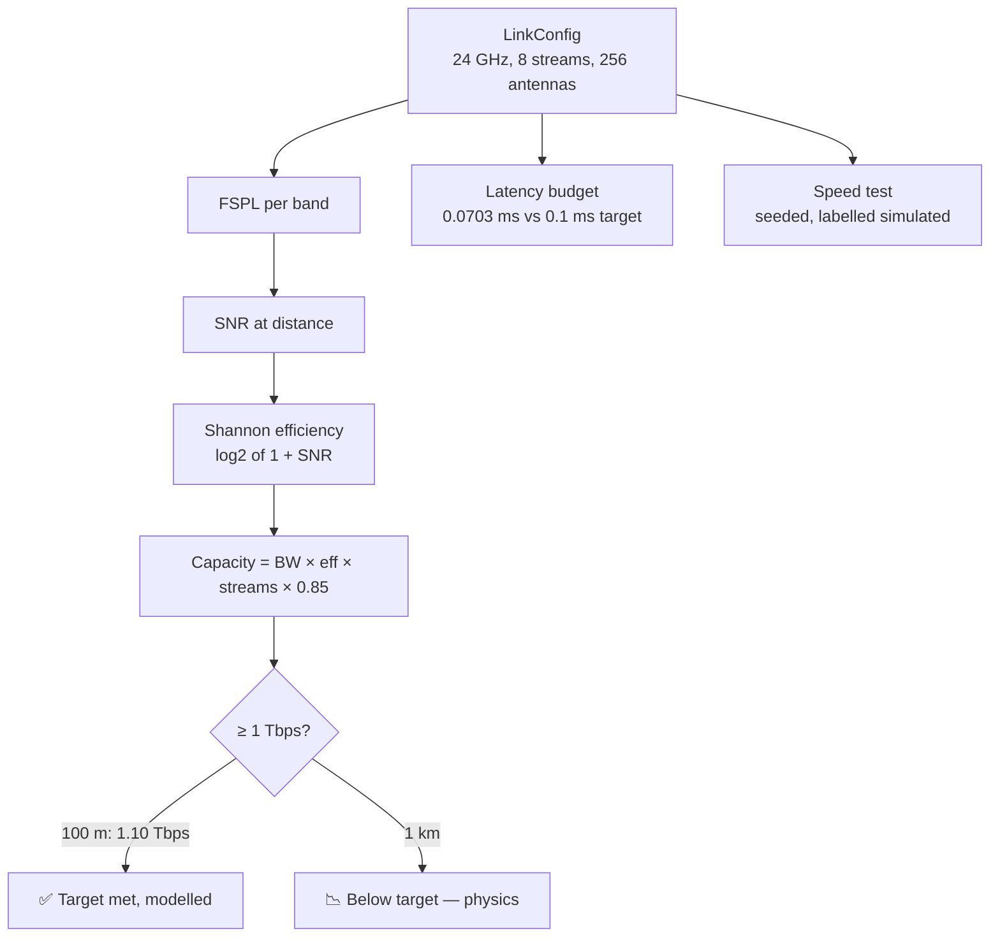

### 🔐 `q6g/qkd.py` — BB84 quantum key distribution

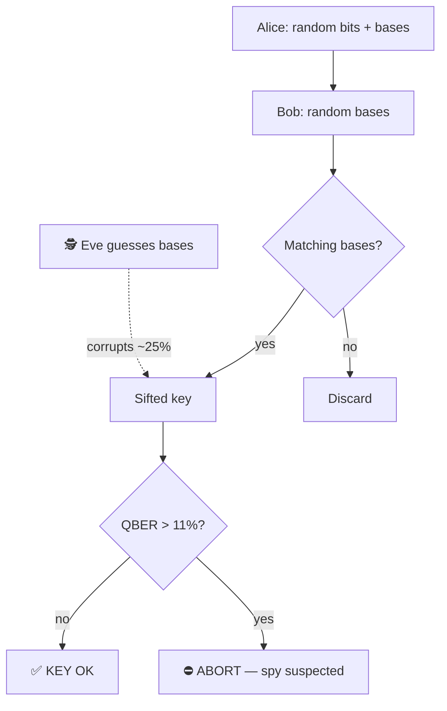

### 📦 `q6g/sandbox_api.py` — the chamber (verbatim merge)

> Copied byte-for-byte from Darion's MonadDB-RE implementation of his `credkellar/sandbox-api` merge — sha256 `28b3365c0466027079a4985520840f6532d7d9a0c5b4239b840e561f06de54b0`, identical in both repos. Its own docstring states the provenance honestly: no public source repo exists for the Hub image, and this is the static, defensive version of its idea.

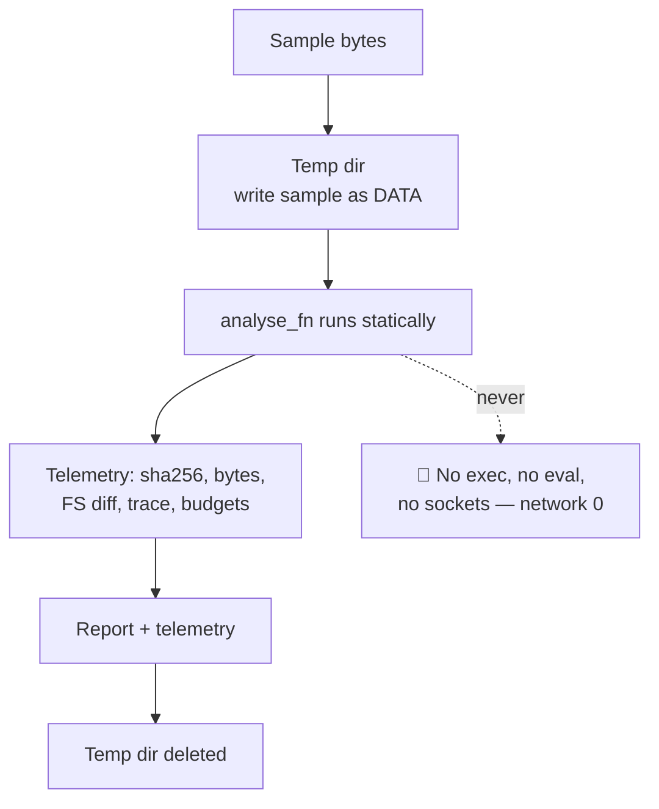

### 🎭 `q6g/dimixer.py` — DI-MIXER decoy identities (merged)

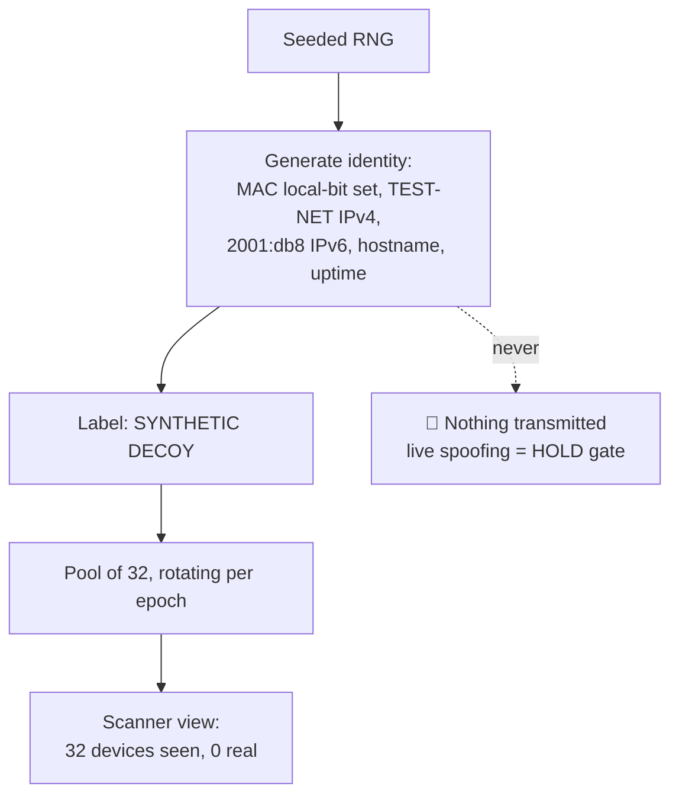

### 🗺️ `q6g/topology.py` — network management topology

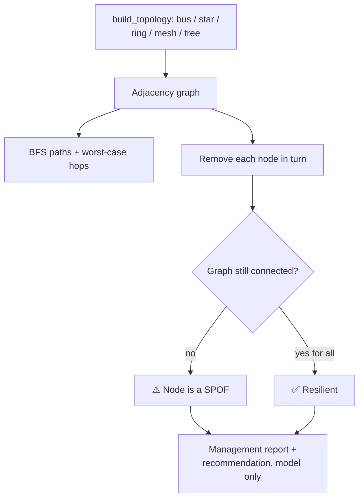

### 🎬 `q6g/flow.py` — all 4 Google Flows, plan only

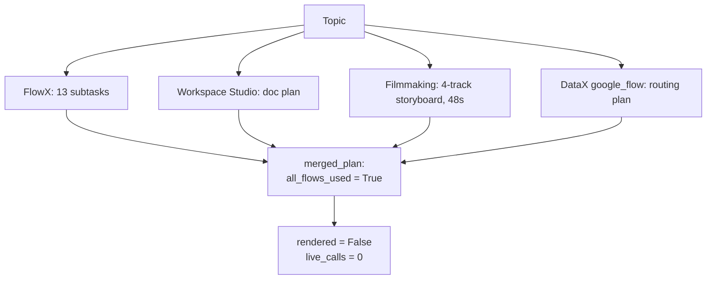

### 🧪 `q6g/payloads.py` — payload triage through the chamber

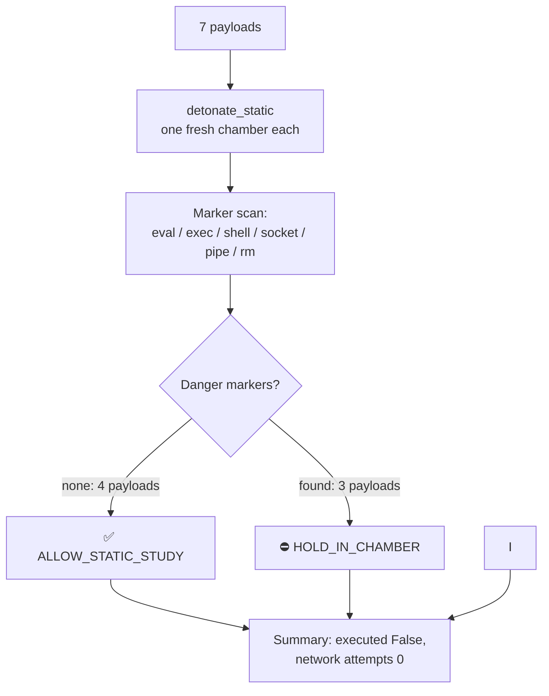

### 🧠 `q6g/council.py` — Gemini Carbon 4 Extended Thinking DECIDER + Muse advisor

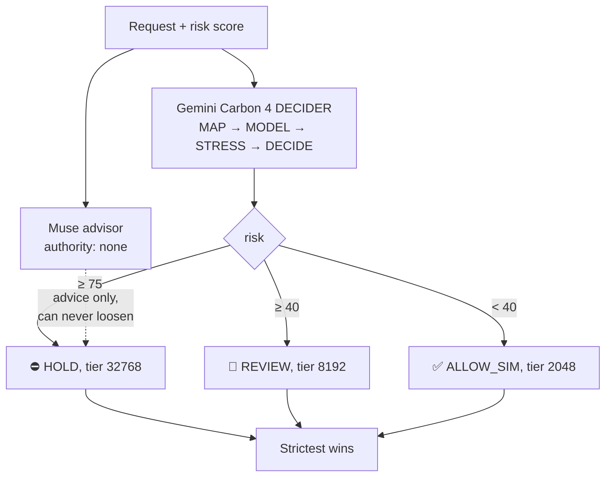

### ⛔ `q6g/gates.py` — the 16 HOLD gates

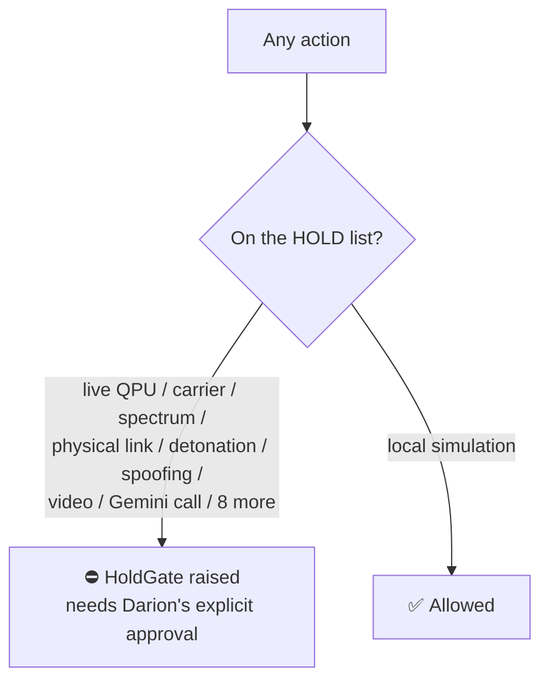

### 🔎 `q6g/checks.py` — self-checks (24/24)

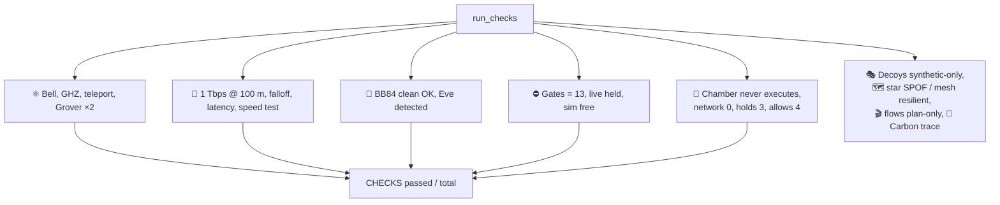

### 🧪 `tests/test_q6g.py` — pytest suite (21 passed)

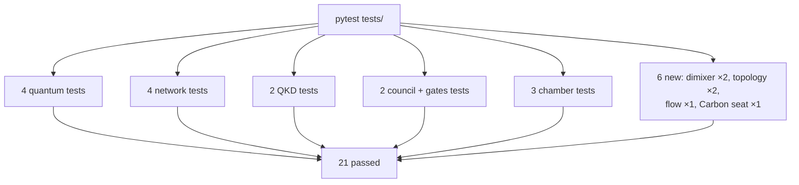

---

## 🌐 Network slices

| Slice | 🎯 Use | 🚀 Peak | ⏱️ Latency |
|---|---|---|---|
| eMBB+ | XR, holographic media | 1 Tbps | 1 ms |
| URLLC++ | Industrial control, V2X | 10 Gbps | 0.1 ms |
| mMTC+ | Massive IoT (10M devices/km²) | 100 Mbps | 10 ms |
| Q-SLICE | Quantum-secured traffic | 1 Gbps key-managed | 1 ms |

## ⛔ HOLD gates (16)

🚫 Live QPU hardware · 🚫 live carrier 6G network · 🚫 RF/THz spectrum transmission · 🚫 claiming or provisioning a physical 1 Tbps link · 🚫 live entanglement distribution · 🚫 routing real user traffic · 🚫 spectrum-license bypass · 🚫 encryption bypass · 🚫 radio/baseband firmware flashing · 🚫 satellite uplink · 🚫 medical/safety-critical control · 🚫 live network reconfiguration · 🚫 detonating a live/unknown sample outside the static chamber · 🚫 deploying DI-MIXER spoofed identifiers on a live network · 🚫 rendering/generating video with Google Flow or any live generator · 🚫 calling the live Gemini / Carbon 4 API with a real key.

## 🧪 Verified (actually run, not claimed)

- ✅ `python -m pytest tests/ -q` → **21 passed**
- ✅ `python main.py checks` → **CHECKS 24/24**, exit 0
- ✅ `python main.py hold-demo` → HOLD fires, exit 2
- ✅ `python main.py sandbox` → 7 payloads: **4 allowed / 3 held**, executed False, network 0
- ✅ `python main.py dimixer` → 32 decoys, all synthetic ranges, scanner sees 0 real devices
- ✅ `python main.py topology` → star SPOF = node 0; mesh resilient
- ✅ `python main.py flow` → 4 flows, rendered False, live calls 0
- 🏷️ Badges: 17 shields.io URLs checked live → **HTTP 200**; real workflow badge.svg URLs → 404 until the workflows are pasted (see Updated Workflows)
- 🐳 Docker: the Dockerfile is provided; the image build was **not** run on the build machine (no Docker there) — first build happens in the Docker Publish workflow

## 📁 Project structure

```
Q6G-1TB/
├── 🖼️ assets/
│   └── cover.png            README cover (owner upload step — binary)
├── 🚪 main.py               CLI entry point (demo/quantum/network/speedtest/qkd/sandbox/dimixer/topology/flow/council/checks/hold-demo)
├── 📦 q6g/
│   ├── ⚛️ quantum.py        statevector simulator, teleportation, Grover
│   ├── 📡 network6g.py      bands, FSPL, Shannon capacity, slices, speed test
│   ├── 🔐 qkd.py            BB84 with eavesdropper detection
│   ├── 📦 sandbox_api.py    sandbox-api chamber, verbatim (sha256 28b3365c…)
│   ├── 🧪 payloads.py       7 payloads + marker-scan triage through the chamber
│   ├── 🎭 dimixer.py        DI-MIXER decoy identities (di-mixerx merge)
│   ├── 🗺️ topology.py       network management topology + SPOF (NetLab engine)
│   ├── 🎬 flow.py           all 4 Google Flows, plan only
│   ├── 🧠 council.py        Carbon 4 DECIDER + Muse advisor (authority: none)
│   ├── ⛔ gates.py          16 HOLD gates
│   └── 🔎 checks.py         24 self-checks
├── 🧪 tests/
│   └── test_q6g.py          21 pytest tests
├── 🔄 workflow-pack/
│   ├── ci.yml               → paste to .github/workflows/ci.yml
│   └── docker-publish.yml   → paste to .github/workflows/docker-publish.yml
├── 🐳 Dockerfile            python:3.12-slim, non-root
├── 📜 LICENSE               MIT
└── 📖 README.md             this file
```

## ⚠️ Honest scope

Real 6G is **not** commercially deployed, no physical 1 Tbps link is measured or claimed, no quantum hardware is accessed, and the sandbox-api Hub image has no public source repo — its chamber here is Darion's own static implementation, copied verbatim from his MonadDB-RE project with provenance stated in its docstring. What *is* real: the link math, the quantum simulation, the BB84 protocol behaviour, the chamber telemetry, the tests, and the checks — all running, all reproducible, all labelled.
